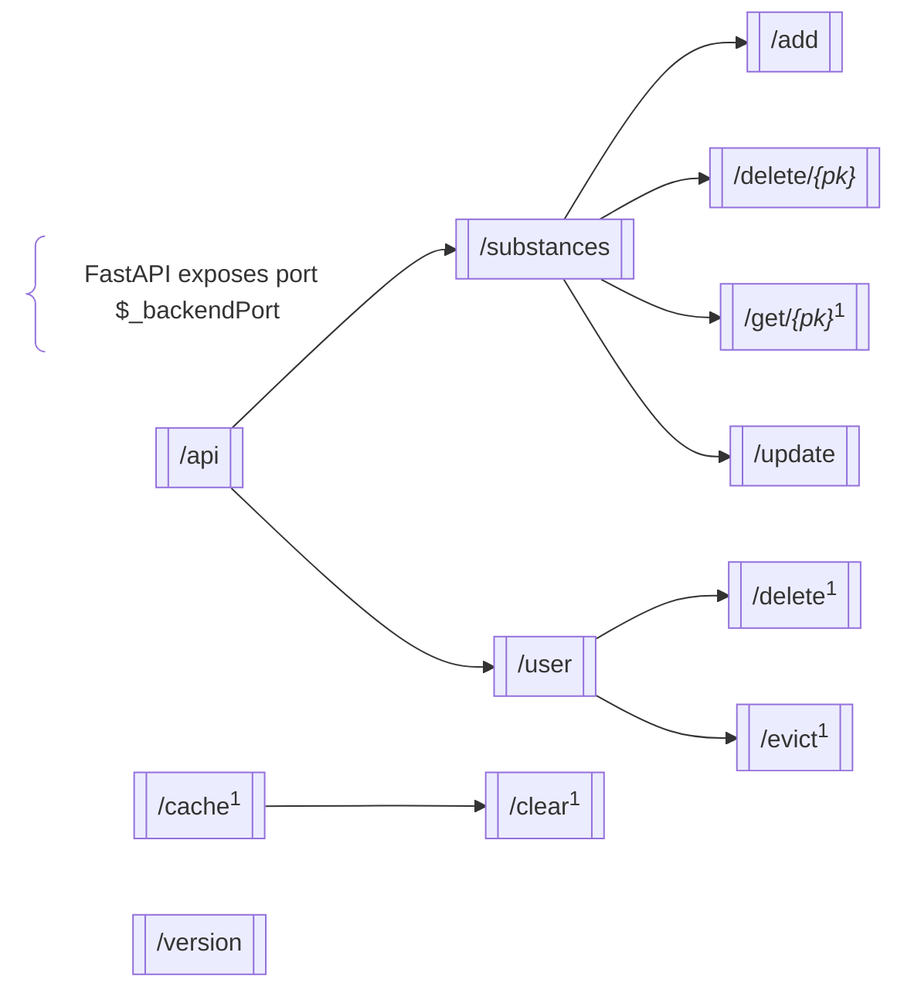

# ") Sᴏʙᴇᴙ Tᴙᴀᴄᴋᴇᴙ (Backend)

### Sobriety tracker

---

 &nbsp;
 &nbsp;
 &nbsp;
 &nbsp;

---

### 🏗️ Architecture

#### API Structure:

###### 1 Not called by UI

---

### API Documentation

|  📄 UI  |  🌐 URL  |
| :-----: | :------: |
| Swagger | `/docs`  |
|  ReDoc  | `/redoc` |
