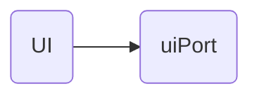
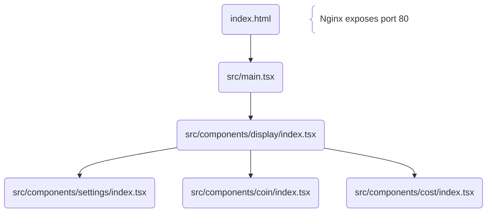

# ") Sᴏʙᴇᴙ Tᴙᴀᴄᴋᴇᴙ (Frontend)

### Sobriety counter <!-- markdownlint-disable-line MD001 -->

---

 &nbsp;
 &nbsp;
 &nbsp;

---

### 🏗️ Architecture

#### Docker Compose Flow:

---

#### React Component Hierarchy:

